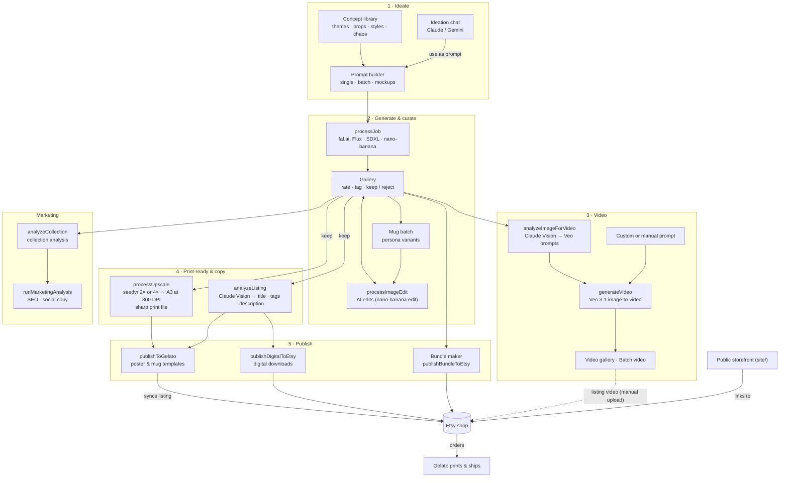

# The Hoodie Gamer — Art Factory

> ▶ **[Watch the visual walkthrough](https://gamer-art-factory-app.web.app/walkthrough/)**: a narrated, animated tour of the dashboard, from concept to Etsy.

An AI-powered art production machine for selling gaming-themed wall art and mugs on **Etsy**, printed and shipped by **Gelato**.

The whole business runs from one React dashboard. It turns a concept into an AI-generated image, upscales it to print resolution, writes the listing copy with Claude, then publishes the product to Gelato for print-on-demand fulfilment and lists it on Etsy. No inventory, no manual design work, no copy-pasting listings.



Every box named after a Cloud Function runs off a Firestore job queue: the dashboard writes a job document (for example `jobs/`, `upscaleJobs/`, `videoJobs/`, `publishJobs/`), and the function picks it up and moves it from `queued` to `processing` to `completed` or `failed`.

## How it works

1. **Ideate.** A concept library (themes, props, body types, styles, "chaos" level) and an AI ideation chat plan new collections.
2. **Assemble prompts.** The prompt builder combines concepts into image prompts, one at a time or as batches.
3. **Generate.** Cloud Functions send the jobs to fal.ai (Flux, SDXL, nano-banana) and save the results to Firebase Storage.
4. **Curate.** In the gallery you rate, filter and tag images with keyboard shortcuts, and can make AI edits from a text instruction (nano-banana edit). The mug batch turns approved personas into style and appearance variants the same way.
5. **Make print-ready.** Images are upscaled with seedvr and converted with `sharp`: 4× for small sources, 2× for 2K sources, which already clears A3 at 300 DPI. Gelato publishing refuses images that are neither 4× upscaled nor at least 4352 px on the long edge.
6. **Write the listing.** Claude Vision looks at each image and writes the Etsy title, description and tags. Gemini is the fallback.
7. **Publish.**
   - **Physical products** (posters and wall art, plus mugs in a separate store) are created in Gelato from product templates. Gelato then syncs them to the connected Etsy shop and handles printing and shipping.
   - **Digital downloads and bundles** are published straight to Etsy through its API (OAuth 2.0 + PKCE).
8. **Make videos.** Claude Vision looks at an image and suggests motion prompts (or you write your own), then Veo 3.1 turns the artwork into a short product video. Videos land in the video gallery, one at a time or in batches, ready to download for Etsy listings and social media.
9. **Market.** Agents analyse whole collections and write SEO copy and social posts.
10. **Storefront.** A separate public site (`site/`) shows published collections and links through to Etsy.

## Tech stack

| Layer | Technology |
|-------|-----------|
| Dashboard | React 19 + Vite + Tailwind CSS v4 + React Router v7 |
| Public site | React 19 + Vite, prerendered (`site/`) |
| Backend | Firebase Cloud Functions (Node.js 20), driven by Firestore job queues |
| Database / storage / auth | Firestore, Firebase Storage, Firebase Auth (single user) |
| Image generation | fal.ai: Flux, SDXL, nano-banana |
| Upscaling | fal.ai: seedvr |
| Video | fal.ai: Veo 3.1 |
| AI agents | Anthropic Claude (`@anthropic-ai/sdk`), with Google Gemini as fallback |
| Image processing | `sharp` |
| Print-on-demand | Gelato API |
| Marketplace | Etsy Open API v3 |

## Repository layout

```
src/            Dashboard (pages, hooks, prompt assemblers)
functions/      Cloud Functions; almost everything is in functions/index.js
  src/          Collection analysis, marketing and ideation agents
  prompts.example/  Generic listing-copy prompts (see below)
site/           Public storefront (separate Vite app)
scripts/        One-off and maintenance scripts (seeding, Etsy auth, bulk tag fixes, sitemap)
firestore.rules, storage.rules, firebase.json
```

## Setup

You need Node.js 20, the Firebase CLI (`npm i -g firebase-tools`), and your own Firebase project on the Blaze plan (Cloud Functions require it). You also need accounts with fal.ai, Anthropic, Gelato and Etsy.

### 1. Install

```bash
git clone https://github.com/booleandifference/art-factory.git
cd art-factory
npm install
cd functions && npm install && cd ..
cd site && npm install && cd ..
```

### 2. Configure the frontend

```bash
cp .env.example .env
cp site/.env.example site/.env
```

Fill in the Firebase web config from **Firebase console → Project settings → Your apps**, or print it with `firebase apps:sdkconfig WEB`. The other keys in `.env` are only used by the local scripts.

### 3. Point at your Firebase project

```bash
firebase login
firebase use --add            # select your project
```

`.firebaserc` maps two hosting targets: `site` for the public storefront and `app` for the dashboard. Update the site names to match your own project.

### 4. Set Cloud Functions secrets

Cloud Functions read their keys from Firebase Secret Manager, not from `.env`:

```bash
firebase functions:secrets:set FAL_KEY
firebase functions:secrets:set ANTHROPIC_API_KEY
firebase functions:secrets:set GEMINI_API_KEY
firebase functions:secrets:set ETSY_API_KEY
firebase functions:secrets:set ETSY_SHARED_SECRET
```

### 5. Add your listing prompts

The prompts that write your Etsy titles, tags and descriptions are your shop's playbook, so they aren't in this repo. Generic versions are in `functions/prompts.example/`. Copy them and make them your own:

```bash
cp -r functions/prompts.example functions/prompts
```

`functions/prompts/` is gitignored but still uploaded by `firebase deploy`. If it's missing, the functions log a warning and fall back to the examples. Longer reference docs (used by `scripts/seedKnowledge.js`) go in the gitignored `private/` folder.

### 6. Gelato config

The Gelato API key and store and template IDs live in the Firestore document `config/gelato`. The mug store ID and its templates are hard-coded in `publishToGelato` in `functions/index.js`, so change them there to use your own.

### 7. Create your user and connect Etsy

1. Create a single email/password user in **Firebase console → Authentication**.
2. Then turn off public sign-up (see [Security](#security)).
3. Sign in to the dashboard and open **Settings → Etsy** to run the OAuth flow. The tokens are stored in `config/etsy`.

### 8. Run locally

```bash
npm run dev                      # dashboard
cd site && npm run dev           # public site
cd functions && npm run serve    # Cloud Functions emulator
```

### 9. Deploy

```bash
npm run build && (cd site && npm run build)
firebase deploy                  # hosting, functions, rules
```

## Scripts

| Command | Description |
|---------|-------------|
| `npm run seed` | Seed Firestore `concepts` and `prompts` |
| `npm run product-book` | Export published listings to Markdown + CSV |
| `node scripts/etsyAuth.js` | Local Etsy OAuth flow (port 3003) for scripts |
| `node scripts/bulkUpdateTags.js` | Bulk-update Etsy tags from a CSV audit |
| `node scripts/generateSitemap.js` | Build the public site's sitemap |

Scripts that use the Admin SDK look for a service-account file such as `service-account.json` in the repo root. That file is gitignored.

## Security

- **Never commit** `.env`, service-account JSON files, `product-book/` (which holds local Etsy tokens), `private/` or `functions/prompts/`. All of these are in `.gitignore`.
- The Firebase web API key in the built frontend is public by design. What protects your data is Firestore security and Auth settings, not that key.
- The rules only allow the owner account (a hard-coded UID in `firestore.rules` and `storage.rules`). Replace it with your own UID, and turn off public sign-up too (**Authentication → Settings → User actions → uncheck "Enable create"**).
- Third-party keys belong in Firebase Secret Manager (functions) or Firestore `config/*` (locked down by the rules), never in source code.

## License

The code is released under the [MIT License](LICENSE). The artwork, brand name and shop content are not covered by it.
